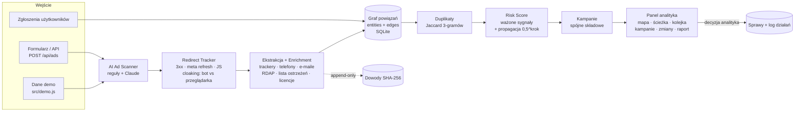

# InvestTrace – MVP

System wspierający analityka w wykrywaniu powiązań między reklamami inwestycyjnymi a podmiotami finansowymi. Odtwarza **ścieżkę inwestora**: reklama → strona lądowania → formularz → przekierowania → platforma. Każdy krok jest udokumentowany dowodami.

> **Zasada nadrzędna:** InvestTrace wskazuje *sygnały ryzyka* i *powiązania wymagające weryfikacji*. Nie orzeka, że ktoś jest oszustem. Każdy wynik ma uzasadnienie z dowodami, a ostateczną decyzję podejmuje analityk.

## Uruchomienie

Wymagany jest Node.js ≥ 22.13. Aplikacja nie ma wymaganych zależności: używa wbudowanego `node:sqlite` i serwera `node:http`.

```powershell
npm start
```

Następnie otwórz http://localhost:3000. Przy pierwszym starcie baza ładuje się danymi demo.

| Polecenie | Co robi |
|---|---|
| `npm start` | serwer + panel analityka |
| `npm test` | testy jednostkowe i integracyjne (`node:test`) |
| `npm run seed` | przywraca fikcyjny zestaw danych demo |
| `docker compose up --build` | uruchomienie w kontenerze (dane w wolumenie `/data`) |

### Analiza treści przez AI (opcjonalnie)

Bez klucza API AI Ad Scanner działa na **regułach** (regex + słowniki PL/EN). Aby włączyć analizę przez Claude:

```powershell
npm install @anthropic-ai/sdk
```

```powershell
$env:ANTHROPIC_API_KEY = "sk-ant-..."; npm start
```

Model i ustawienia: domyślnie `claude-opus-5-5` (zmienna `INVESTTRACE_MODEL`), `effort: low`, structured outputs (JSON Schema) i server-side fallback przy odmowie. `INVESTTRACE_LLM=off` wyłącza LLM. Wyniki LLM są **walidowane**: sygnał, którego cytatu nie ma dosłownie w treści reklamy, jest odrzucany. Wyniki LLM są łączone z wynikami reguł. Prompt systemowy i schemat są w [src/scanner.js](src/scanner.js) (`SCANNER_SYSTEM_PROMPT`, `SCANNER_JSON_SCHEMA`).

## Architektura



### Struktura projektu

```
investtrace/
├─ server.js            serwer HTTP: REST API + pliki statyczne, rate limit
├─ src/
│  ├─ schema.sql        schemat bazy (SQLite, przenośny do PostgreSQL)
│  ├─ db.js             połączenie, encje, krawędzie, dowody, wagi
│  ├─ scanner.js        AI Ad Scanner: reguły + Claude (structured output) + walidacja cytatów
│  ├─ redirect.js       Redirect Tracker: przekierowania, ochrona SSRF, cloaking, analiza HTML
│  ├─ pipeline.js       import → skan → ścieżka → enrichment → graf; „odcisk” reklamy
│  ├─ risk.js           sygnały, Risk Score, duplikaty, propagacja, kampanie
│  ├─ api.js            zapytania dla panelu (feed, kolejka, graf, kampanie, oś czasu…)
│  ├─ report.js         raport HTML do druku / PDF
│  └─ demo.js           generator fikcyjnych danych demo
├─ public/              panel analityka (HTML/CSS/JS + Cytoscape.js)
├─ test/core.test.js    testy
└─ docs/                przykładowy raport i paczka dowodowa
```

### Model danych

Tabele: `ads`, `advertisers`, `pages`, `redirect_chains`, `redirect_steps`, `entities` (węzły grafu: reklama, konto, influencer, domena, telefon, e-mail, IP, tracker, firma, zgłoszenie), `edges` (typowane, z `evidence_id`, `source`, `confidence`, `first_seen`, `last_seen`), `evidence` (append-only, wymuszane triggerami), `signal_weights`, `risk_signals`, `risk_scores`, `campaigns`, `cases`, `analyst_actions`, `snapshots`, `user_reports`, `warning_list`, `licensed_entities`. Pełny schemat jest w [src/schema.sql](src/schema.sql).

Typy krawędzi: `PROMOTES`, `LINKS_TO`, `REDIRECTS_TO`, `USES_PHONE`, `USES_EMAIL`, `USES_TRACKER`, `HOSTED_ON`, `SIMILAR_TO`, `OPERATED_BY`, `MENTIONED_IN_WARNING_LIST`, `REPORTED_IN`.

### Risk Score

1. **Sygnały bazowe** pochodzą z treści (obietnica zysku, presja czasu, autorytet, social proof, krypto/forex, komunikatory), ze ścieżki (cloaking, formularz zbierający telefon) i z enrichmentu (młoda domena, ukryty WHOIS + offshore, lista ostrzeżeń, brak licencji / licencja −20).
2. **Sygnały sieciowe:** wspólny telefon, e-mail lub tracker z reklamami wysokiego ryzyka, podobna treść z innego konta, zgłoszenia użytkowników.
3. **Wynik** = `100·(1 − e^(−suma/60))`. Dzięki nasyceniu kolejne sygnały wciąż podnoszą wynik, więc ranking się różnicuje, ale wynik nigdy nie przekracza 100. Poziomy: <25 Niski, <50 Średni, <75 Wysoki, ≥75 Krytyczny.
4. **Propagacja:** reklama powiązana z siecią dostaje `max(wynik sąsiada · 0,5^kroki)`, jeśli to więcej niż jej własny wynik. Panel pokazuje to jako osobny, wyjaśniony sygnał.

Wagi można zmieniać w panelu („Wagi ryzyka”). Po zapisaniu wszystkie wyniki są przeliczane.

**„Odcisk” reklamy** to identyfikatory z jej *własnej* ścieżki. Skracacze linków są oznaczane jako `generic` i nie łączą kampanii, żeby wspólny bit.ly nie skleił niezależnych nadawców.

## API

| Metoda | Ścieżka | Opis |
|---|---|---|
| POST | `/api/ads` | dodanie reklamy `{text, target_url?, platform?, advertiser_name?, is_influencer?}`: pełny pipeline |
| POST | `/api/ads/{id}/scan` | ponowna analiza AI i śledzenie przekierowań |
| GET | `/api/ads/{id}` | szczegóły: sygnały, dowody, ścieżka, sprawa |
| GET | `/api/ads?limit=` | feed najnowszych reklam |
| GET | `/api/graph?center=&depth=2&minRisk=&campaign=` | graf / podgraf |
| GET | `/api/entities/{id}` | węzeł: powiązania, reklamy, historia zmian |
| GET | `/api/journey/{adId}` | ścieżka inwestora |
| GET | `/api/queue` | ranking do weryfikacji |
| GET | `/api/campaigns`, `/api/campaigns/{id}` | kampanie |
| PATCH | `/api/cases/{id}` | `{status?, notes?, assignee?, tags?}` + log działań |
| GET | `/api/reports/{caseId}` | raport HTML (druk → PDF) |
| GET | `/api/cases/{id}/evidence.json` | paczka dowodowa (manifest + treść dowodów + SHA-256) |
| GET | `/api/search?q=` | wyszukiwarka globalna |
| GET | `/api/timeline` | historia zmian |
| GET/PUT | `/api/weights` | wagi sygnałów |
| GET/POST | `/api/user-reports` | zgłoszenia użytkowników (telefony maskowane w odczycie) |
| POST | `/api/demo/reset` | przywrócenie danych demo |

## Dane demo

Zestaw zawiera 33 reklamy, 14 kont (w tym 2 fikcyjnych influencerów), 16 domen, 3 kampanie, 4 zgłoszenia użytkowników i 7 zmian w historii.

- **Kampania „Trade Pro Capital”** (scenariusz główny, 14 reklam z 5 kont): skracacz → fałszywy artykuł (wspólny Pixel) → formularz → platforma z (fikcyjnej) listy ostrzeżeń. W połowie okresu formularz przełącza się na domenę-lustro `tpc-invest.test`. Część ścieżek ma cloaking.
- **Kampania „QuantumBit”**: bot AI do krypto, kontakt przez Telegram.
- **Kampania „Green Energy Fund”**: fałszywy „program rządowy”.
- **Fałszywe alarmy:** licencjonowany broker i bank (sygnał licencji −20) oraz kurs ETF. Wszystkie dostają wynik 0, mimo że broker wspomina CFD, a bank podaje oprocentowanie.
- **Propagacja:** neutralna reklama „Porady Finansowe 24h” ma ten sam numer telefonu co kampania główna. Jej własny wynik to 34, a po propagacji 48.

Wszystkie dane są **fikcyjne**: domeny w zarezerwowanej strefie `.test`, numery z nieistniejącej puli `+48 000 000 xxx`, wymyślone osoby i firmy. Listy ostrzeżeń i rejestry licencji w demo są oznaczone `(DEMO)`.

## Bezpieczeństwo i prywatność

- **Redirect Tracker** nie wykonuje JavaScriptu i nie pobiera plików (treści inne niż HTML są pomijane). Obsługuje tylko http/https i blokuje adresy prywatne, lokalne i `.test`/`.local` (SSRF). Limity: 10 kroków, 8 s na krok, 2 MB na stronę. Cloaking wykrywa przez porównanie ścieżki dla przeglądarki mobilnej i dla bota.
- **Dowody** są append-only: triggery blokują `UPDATE` i `DELETE`, każdy dowód ma SHA-256 i autora.
- **Log audytowy** decyzji analityka trafia do `analyst_actions`.
- **Rate limit** na zapisy: 30 żądań na minutę na IP. Serwer domyślnie nasłuchuje tylko na `127.0.0.1`.
- **Prywatność:** zgłoszenia nie przechowują danych zgłaszającego, a numery w odczycie zgłoszeń są maskowane.

## Ograniczenia MVP i co dalej

| Obszar | W MVP | Wersja produkcyjna |
|---|---|---|
| Stos | Node.js bez zależności, SQLite, vanilla JS + Cytoscape | zgodnie z założeniami: React/TS, FastAPI lub NestJS, PostgreSQL + pgvector, Redis/Celery, MinIO |
| Crawler | `fetch` bez JS, bez zrzutów ekranu (podgląd strony jest schematyczny) | Playwright w izolowanym kontenerze, zrzuty ekranu, różne geolokalizacje; ochrona przed DNS rebinding (pinning IP) |
| Podobieństwo | Jaccard 3-gramów słów | embeddingi tekstu, pHash obrazów, podobieństwo szablonów HTML |
| Kampanie | spójne składowe grafu | Louvain / Leiden, centralność |
| Enrichment | RDAP (rdap.org) dla prawdziwych domen, lokalne listy | DNS/ASN, Certificate Transparency, import listy KNF, IOSCO I-SCAN i rejestrów ESMA/FCA/CySEC, typosquatting |
| Raport | HTML do druku → PDF, manifest JSON | generowany PDF + ZIP z artefaktami |
| Monitoring | historia zmian z danych demo | cykliczny re-skan (np. co 24 h) z diffem treści |
| Konta | jeden analityk demo | uwierzytelnianie, role (analityk / admin / odczyt), kalibracja wag na podstawie decyzji |
